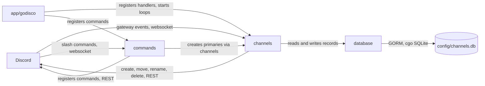

# Architecture

## Overview

godisco is a single process holding one Discord gateway session. It reacts to
gateway events, calls the Discord REST API to create, move, rename and delete
voice channels, and records the channels it manages in a local SQLite database.
Commands to run it are in the [README](README.md#getting-started).

## Components

- **`app/godisco`** — entrypoint. Loads the configuration, opens the database,
  registers the handlers, opens the session and owns shutdown.
- **`channels`** — the core of the bot: voice-state handling, reconciliation,
  name templates and the rename loop.
- **`commands`** — registers the slash commands and handles them. Primary
  channels are created through `channels`.
- **`database`** — opens the SQLite database and runs the migrations.
- **`models`** — the `PrimaryChannel` and `SecondaryChannel` GORM models.
- **`logging`** — builds the zap logger injected into the other packages.

## Data flow

**Voice-state updates.** `channels.VCUpdate` receives every voice-state change.
Joining a primary channel creates a secondary channel, records it and moves the
user into it. Leaving a secondary channel that ends up empty deletes the channel
and its record.

**Reconciliation.** `channels.GuildCreate` runs on every `GUILD_CREATE`, so at
startup and after each new gateway session. It compares the guild's records
with the channels and voice states Discord reports:

| Channel on Discord | Action |
| --- | --- |
| missing | drop the record |
| present and empty | delete the channel, then drop the record |
| present and occupied | keep both |

A failed channel deletion keeps the record, and the next `GUILD_CREATE` retries
it. Discord answering "unknown channel" counts as already deleted.

**Manual deletions.** `channels.ChannelDelete` drops the record of a secondary
channel as soon as it disappears from Discord, whoever removed it.

**Rename loop.** `channels/loops.go` walks every record every 5 minutes, renders
its template and renames the channel when the name changed. A channel missing
from the state is logged and skipped, so one bad record cannot stop the sweep.

## State and persistence

`config/channels.db` holds two tables: `primary_channels` (template and default
name of each primary) and `secondary_channels` (one row per live secondary, with
its parent and creator). The Discord session state, kept in memory by discordgo,
is the source of truth for what exists and who is connected. The database only
says which channels the bot manages.

## Design decisions

**Reconciling on `GUILD_CREATE`, not on a timer.** The gateway replays nothing
across a new session, so events are only lost around one, and `GUILD_CREATE` is
what delivers the snapshot needed to compare against. A timer would add Discord
calls while the handlers already keep the records right in a running session.

**Ranks are derived from the records.** A channel's number is its position among
the sorted IDs of its siblings, and a new channel ranks after all of them. No
counter can drift, but a stale record shifts every number, which is what
reconciliation protects against.

**The rename interval is fixed at 5 minutes.** Discord rate-limits channel
renames to 2 per 10 minutes per channel.

## Invariants and constraints

- Ranks are 1-based everywhere: `{{.Number}}`, the `#<rank> <default-name>`
  fallback, and `{{.Icao}}`, where rank 1 is Alfa.
- `{{.Icao}}` wraps back to Alfa after Zulu.
- An unavailable guild's `GUILD_CREATE` lists no channels and never reaches
  reconciliation, otherwise it would drop every record.
- Reconciliation ignores records created after it started: their channel can be
  absent from the snapshot, or still waiting for its creator to be moved in.
- A member can have no cached presence. The name template treats it as having
  no activity.

## Limitations

- One process per database: SQLite and the in-memory session state assume a
  single writer.
- A primary channel deleted by hand keeps its record.
